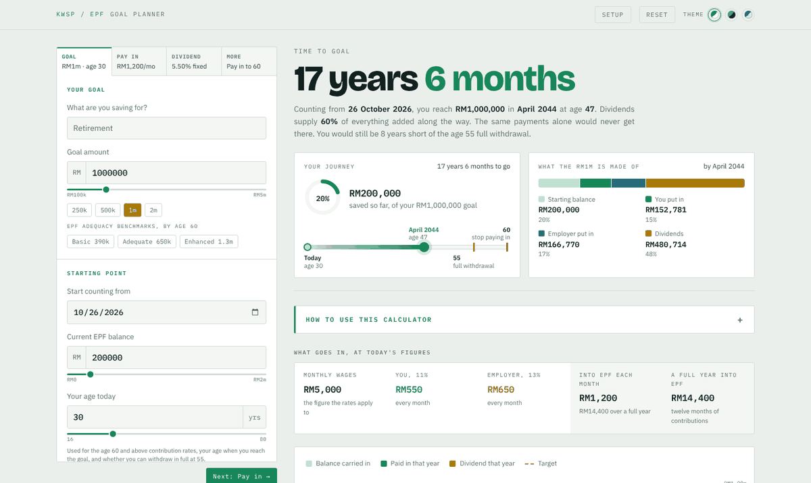

# EPF Goal Planner

**Find out when your EPF savings will reach your goal, and what gets you there sooner.**

*For Malaysian KWSP / EPF members. Works on any phone or computer, needs no sign-up, and your numbers never leave your device.*

## What it is

- **One clear answer**: how many years and months until you reach your goal, the date, and how old you'll be. For example: *17 years 6 months, reaching RM1,000,000 in April 2044 at age 47.*
- **A guided start**: five quick questions (your goal, your age, what's in your EPF now, your salary or what you pay in yourself, and any yearly bonus or top-up). Or skip them and go straight to the dashboard.
- **See every change as you make it**: the inputs sit in four tabs (Goal, Pay in, Dividend, More) beside the answer, so dragging a slider moves the answer, the chart and the timeline straight away. On a phone, a bar at the bottom keeps the answer in view.
- **Your journey at a glance**: how much of the goal you've already saved, and a timeline from today to the goal with age 55 (full withdrawal) and the age you stop contributing marked.
- **Where the money comes from**: one bar splits the final balance into your starting balance, your money, your employer's, government matching and dividends. It's often surprising how much comes from dividends.
- **Year by year**: an animated chart (hover or tap a year for its breakdown) and a full table you can download as a spreadsheet (CSV).
- **"If you changed one thing"**: how much sooner you'd get there by paying a bit more, adding a yearly top-up, earning a better dividend or starting with more. Press **Try it** to apply the change, and undo it just as easily.
- **EPF's own rules built in**: statutory rates (11% from you; 13% from your employer up to RM5,000 of wages, 12% above), the rates for non-Malaysian members and for age 60 and above, re-checked every projected year as your salary grows. Dividends are credited once a year, the way EPF does it, and the balance is split across Akaun Persaraan, Sejahtera and Fleksibel.
- **Goals to pick from**: EPF's retirement benchmarks for age 60 (Basic RM390k, Adequate RM650k, Enhanced RM1.3m), quick picks from RM250k to RM2m, or any amount you like.
- **Dividend rates your way**: a fixed rate (5.50% to start), the average of the last 5, 10 or 20 years, a trend line, or EPF's actual past rates replayed year by year, for Konvensional or Shariah savings.
- **Today's money**: an inflation setting shows what the final balance is worth in today's ringgit.
- **Three looks**: light, dark and KWSP blue.

## Good to know

| | |
|---|---|
| Your data | Stays in your own browser, saved so it's there next time. Nothing is uploaded. **Reset** clears it. |
| Dividend rates | Declared EPF rates up to 2025. Future years use the rate or method you choose: dividends are declared after each year ends and are not guaranteed. |
| Updates | Every visit checks for newer files, so an update shows on the next refresh. |
| Not modelled | Withdrawals, tax relief and the yearly cap on self-contributions. Payslips may differ by a few ringgit, because EPF rounds contributions using wage bands. |

## Use it offline

Download `index.html` and open it in any browser. Nothing else is needed.

## Credits

Dividend rates are KWSP's published figures, linked from the planner. This is a planning tool, not financial advice, and it is not affiliated with or endorsed by KWSP. Contribution rates, incentives and benchmarks can change, so check anything you plan to act on at [kwsp.gov.my](https://www.kwsp.gov.my).
